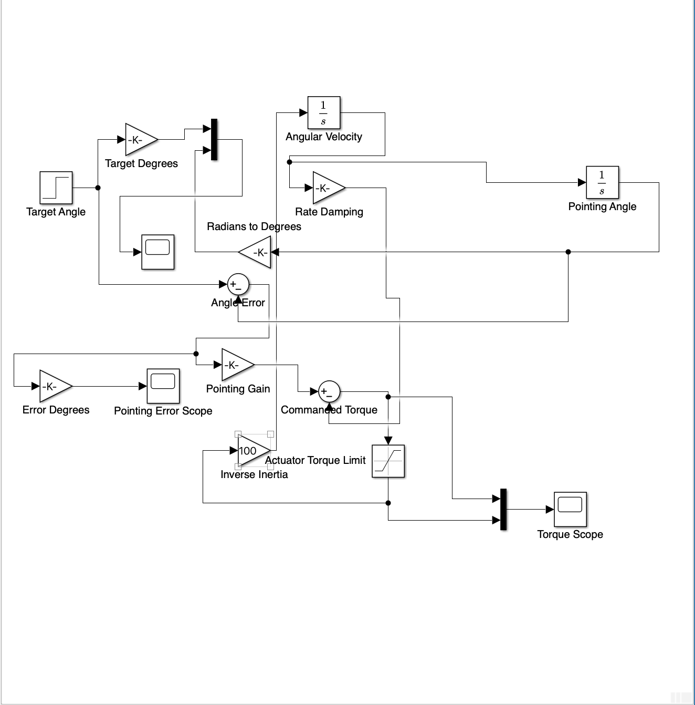
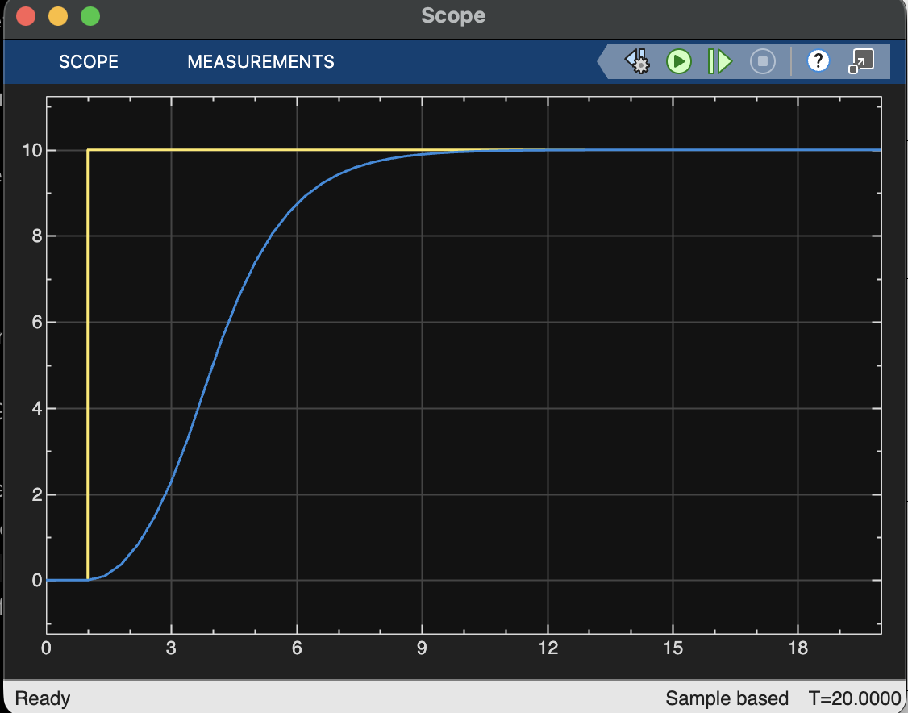
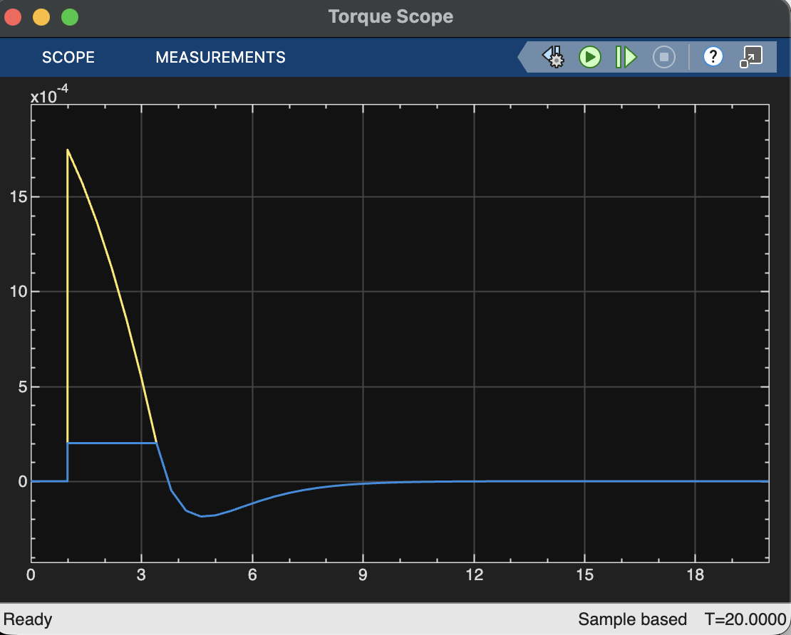
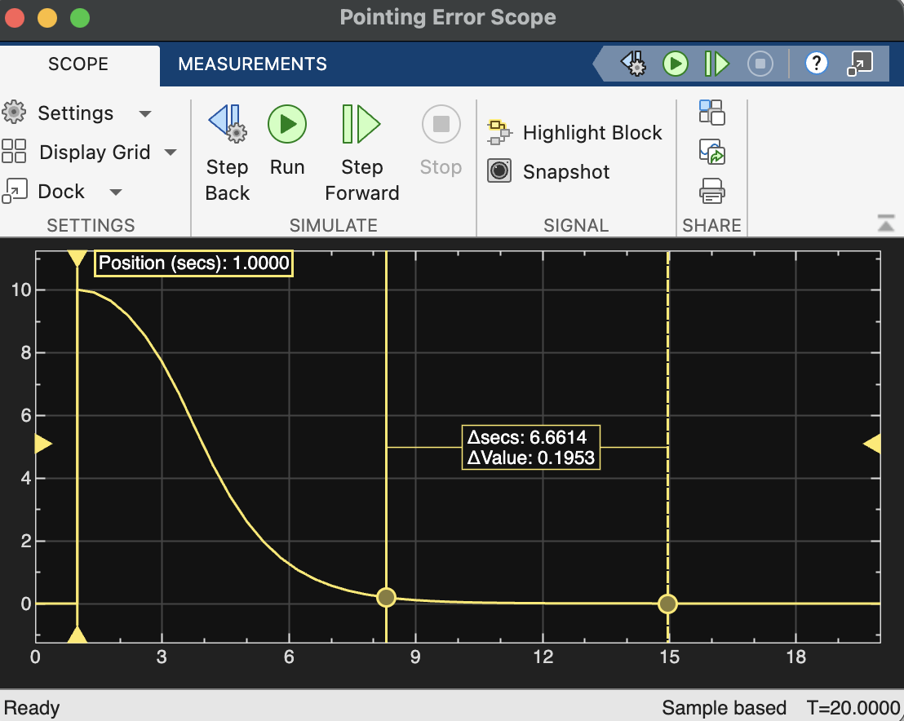

# Aurora-1 — Single-Axis ADCS Simulation

## Project Overview

This project extends the Aurora-1 CubeSat digital engineering portfolio through the development of a single-axis Attitude Determination and Control System (ADCS) simulation using MATLAB/Simulink.

The simulation models spacecraft rotational dynamics and uses closed-loop feedback control to execute a commanded pointing maneuver.

**Project Status:** Initial single-axis simulation completed; additional verification and development planned.

## Objectives

- Model spacecraft angular motion using rotational dynamics.
- Implement proportional-derivative (PD) attitude control.
- Simulate actuator torque saturation.
- Evaluate pointing accuracy, settling behavior, and control torque.
- Establish a foundation for future three-axis attitude control and fault-detection capabilities.

## System Architecture

The simulation includes:

1. **Command Input:** Generates a desired spacecraft pointing angle.
2. **Pointing Error:** Calculates the difference between commanded and simulated orientation.
3. **PD Controller:** Uses pointing error and angular velocity feedback to calculate corrective torque.
4. **Actuator Saturation:** Limits applied torque to represent actuator constraints.
5. **Rotational Dynamics:** Integrates angular acceleration to obtain angular velocity and pointing angle.
6. **Monitoring:** Records attitude response, pointing error, and torque behavior.

### Simulink Model

## Mathematical Model

The controller follows the general proportional-derivative control law:

\[
\tau_{cmd}=K_p(\theta_{target}-\theta)-K_d\omega
\]

The simplified rotational dynamics are:

\[
\dot{\omega}=\frac{\tau_{applied}}{I}
\]

\[
\dot{\theta}=\omega
\]

Where:

- \(K_p\): Proportional pointing gain
- \(K_d\): Angular-rate damping gain
- \(\theta\): Simulated spacecraft pointing angle
- \(\omega\): Angular velocity
- \(I\): Assumed spacecraft moment of inertia
- \(\tau\): Control torque

## Initial Simulation Results

A 20-second simulation was conducted using a 10-degree step command.

### Attitude Response

The simulated spacecraft approached the commanded 10-degree orientation smoothly, with no visible overshoot or sustained oscillation.

### Control Torque

The actuator saturation model limited applied torque during the initial maneuver. The controller subsequently generated opposing torque to reduce angular velocity as the spacecraft approached its target orientation.

### Pointing Error

Pointing error decreased from approximately 10 degrees toward zero. The initial results indicate stable tracking under nominal simulated conditions.

### Preliminary Performance Summary

| Metric | Observed Result |
|---|---|
| Commanded angle | 10° |
| Simulation duration | 20 seconds |
| Visible overshoot | Approximately 0% |
| Settling behavior | Approximately 9–10 seconds from simulation start |
| Final pointing error | Approximately 0° |
| Response | Smooth, non-oscillatory |

*Values are preliminary visual estimates from simulation plots, not formal verification measurements.*

## Tools and Technologies

- MATLAB
- Simulink
- Feedback control systems
- Spacecraft rotational dynamics
- Engineering modeling and simulation

## Limitations

This initial model represents simplified single-axis rotational dynamics. It does not yet establish validated performance under external disturbances, sensor noise, actuator imperfections, or coupled three-axis motion.

## Future Development

- Test negative and larger commanded pointing angles.
- Introduce external disturbance torques.
- Evaluate controller robustness under varying moments of inertia.
- Model sensor noise and actuator limitations.
- Expand toward three-axis spacecraft attitude control.
- Explore AI/ML-assisted anomaly detection.
- Investigate integration with the Aurora-1 Mission Control dashboard.

## Engineering Contribution

Independently developed and assembled the Simulink control-system model, with AI-assisted troubleshooting of specific data and modeling inaccuracies. Evaluated the simulated attitude response, control torque, and pointing-error behavior.

This simulation is part of the continuing Aurora-1 CubeSat digital engineering project.
